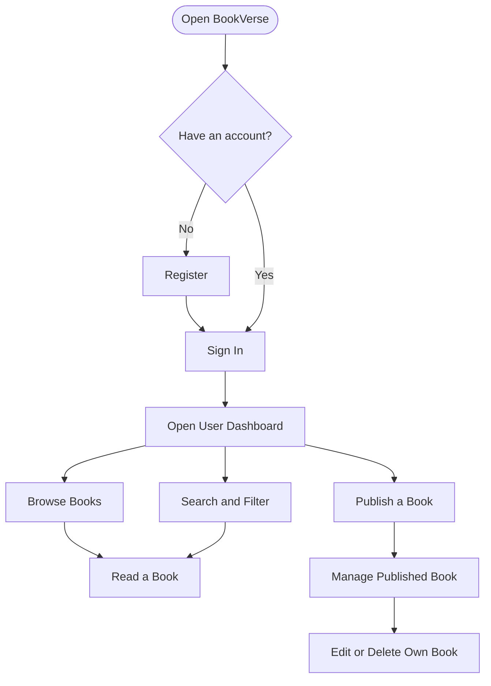
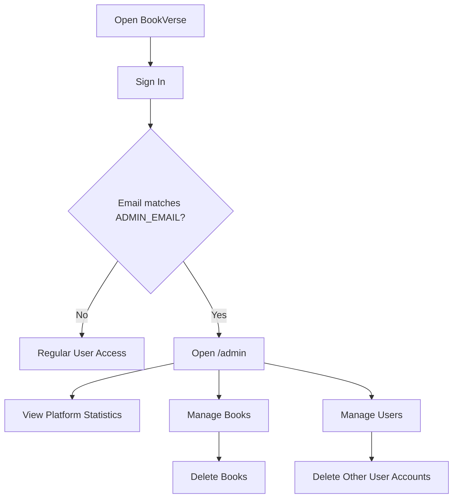
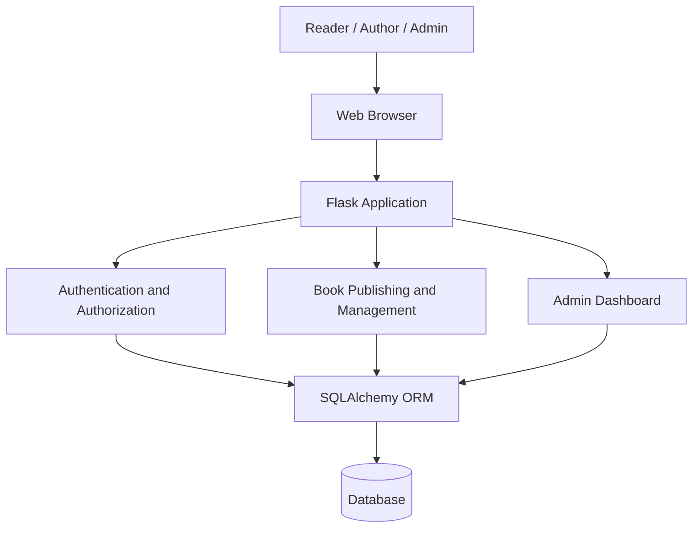
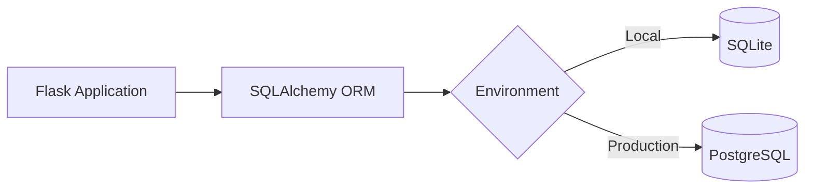

# 📚 BookVerse — Read & Publish Books

<p align="center">
  <strong>A community-driven platform where readers discover stories and writers publish their own books.</strong>
</p>

<p align="center">
  <a href="https://bookverse-read-publish-books.onrender.com">
    
  </a>
  
  
  
  
</p>

<p align="center">
  <a href="https://bookverse-read-publish-books.onrender.com">🌐 Visit Live Website</a>
</p>

---

## 📖 Project Overview

**BookVerse** is a web-based community publishing platform that brings readers and writers together in one place.

Users can create accounts, discover books, search for stories, and publish their own written work. Authors can manage their published books, while administrators can oversee users, books, and platform statistics through a dedicated dashboard.

The application is built using **Python Flask** and **SQLAlchemy**, with PostgreSQL for the deployed environment and SQLite for local development.

### 🎯 Project Goals

- Create a centralized platform for reading and publishing books.
- Give writers the ability to publish and manage their work.
- Help readers discover stories through browsing and search.
- Provide administrators with tools to manage platform content and users.
- Build a practical, deployable full-stack web application.

## 🌐 Live Deployment

<badge color="success">Live on Render</badge>

**Website:** [https://bookverse-read-publish-books.onrender.com](https://bookverse-read-publish-books.onrender.com)

Visit the live application to explore its available functionality:

- Browse published books.
- Create a user account.
- Sign in to the platform.
- Publish and read stories.
- Explore the publishing experience.

*Note: The first request may take longer if the Render service has been idle.*

---

## ✨ Key Features

| Module | Functionality |
|---|---|
| User Authentication | Registration, sign-in, and hashed password storage |
| Book Discovery | Browse and explore published books |
| Search and Filtering | Search and filter available books |
| Online Publishing | Publish books and stories |
| Author Management | Edit or delete your own books |
| Reading Experience | Read published books online |
| Admin Dashboard | View platform statistics, users, and books |
| Book Administration | Administrative book management |
| User Administration | Administrative user management |
| Project Information | Display project manager and contact information |
| Database Flexibility | PostgreSQL on Render and SQLite locally |

## 👤 User Roles

### 1. Reader

Readers can:

- Register for an account.
- Sign in securely.
- Browse published books.
- Search and filter books.
- Read available stories.

### 2. Author

Authors can:

- Publish their own books.
- Read published content.
- Edit their own books.
- Delete their own books.

### 3. Administrator

The administrator has access to the management dashboard.

Administrative capabilities include:

- View platform statistics.
- View registered users.
- View published books.
- Delete books.
- Delete other user accounts.

Administrator access is determined by comparing the signed-in user's email with the configured `ADMIN_EMAIL` environment variable.

---

## 🔄 Application Workflow

### User and publishing workflow



### Administrator workflow



---

## 🏗️ System Architecture

BookVerse uses a Flask-based web application architecture.



### Architecture components

| Component | Responsibility |
|---|---|
| Frontend | User interaction and book browsing |
| Flask | Server-side application and request handling |
| Authentication | User registration, login, and access control |
| Publishing Module | Book creation and author-owned book management |
| Admin Module | Platform statistics and administrative operations |
| SQLAlchemy | Object-relational database interaction |
| PostgreSQL | Production database on Render |
| SQLite | Local development database |

---

## 🗄️ Database and Storage

BookVerse uses **SQLAlchemy** to interact with its relational database.

| Environment | Database |
|---|---|
| Local development | SQLite |
| Render deployment | PostgreSQL |

### Database interaction



The application uses its ORM to manage database operations. Exact table names, columns, and relationships should be documented from the current SQLAlchemy models rather than assumed.

---

## 🛠️ Technology Stack

| Layer | Technology | Purpose |
|---|---|---|
| Programming Language | Python | Application development |
| Backend Framework | Flask | Web application and routing |
| ORM | SQLAlchemy | Database operations |
| Production Database | PostgreSQL | Persistent production storage |
| Local Database | SQLite | Local development |
| Authentication | Flask application authentication and password hashing | User account security |
| Application Server | Gunicorn | Production WSGI serving |
| Deployment | Render | Hosting and deployment |

---

## 🚀 Run Locally

### Prerequisites

Install:

- Python
- pip
- Git
- VS Code or another code editor

### 1. Clone the repository

```bash
git clone <YOUR_GITHUB_REPOSITORY_URL>
cd <YOUR_PROJECT_DIRECTORY>
```

### 2. Install dependencies

```bash
pip install -r requirements.txt
```

### 3. Configure environment variables

Set the required application configuration before starting the application.

**macOS / Linux**

```bash
export SECRET_KEY="use-a-long-random-secret"
export ADMIN_EMAIL="your-admin-email@example.com"
export SITE_MANAGER_NAME="Lakshya Kansal"
export SITE_CONTACT_EMAIL="optional-contact@example.com"
```

**Windows PowerShell**

```powershell
$env:SECRET_KEY="use-a-long-random-secret"
$env:ADMIN_EMAIL="your-admin-email@example.com"
$env:SITE_MANAGER_NAME="Lakshya Kansal"
$env:SITE_CONTACT_EMAIL="optional-contact@example.com"
```

### 4. Start the application

```bash
python app.py
```

### 5. Open BookVerse

Visit:

```text
http://127.0.0.1:5000
```

Register a new account and explore the publishing platform.

---

## ⚙️ Environment Variables

| Variable | Purpose |
|---|---|
| `SECRET_KEY` | Secret used for application session/security configuration |
| `ADMIN_EMAIL` | Email address that receives administrator access |
| `SITE_MANAGER_NAME` | Project manager name displayed by the application |
| `SITE_CONTACT_EMAIL` | Optional contact email |
| `DATABASE_URL` | Database connection URL, used for the configured deployment database |

### Important configuration notes

- Use a long, random `SECRET_KEY`.
- Never commit secrets or database credentials to GitHub.
- Set `ADMIN_EMAIL` before registering the administrator account.
- The account email must match `ADMIN_EMAIL` to receive administrator access.
- Keep the production database connection configured in Render.

---

## ☁️ Render Deployment

BookVerse is deployed on Render.

### Live application

[Open BookVerse](https://bookverse-read-publish-books.onrender.com)

### Deployment configuration

| Setting | Value |
|---|---|
| Platform | Render |
| Service Type | Web Service |
| Build Command | `pip install -r requirements.txt` |
| Start Command | `gunicorn app:app` |
| Production Database | PostgreSQL |

### Deployment steps

1. Push the complete project to your GitHub repository.
2. Sign in to Render.
3. Connect your GitHub repository.
4. Create a web service or update the existing service.
5. Configure the build and start commands.
6. Add the required environment variables.
7. Connect the Render PostgreSQL database.
8. Deploy the latest commit.
9. Open the deployed website and test registration, login, publishing, and reading.

### Required environment variables on Render

```text
SECRET_KEY=your-long-random-secret
ADMIN_EMAIL=your-admin-email@example.com
SITE_MANAGER_NAME=Lakshya Kansal
SITE_CONTACT_EMAIL=optional-contact@example.com
DATABASE_URL=your-render-postgresql-connection
```

Use Render's actual PostgreSQL connection value for `DATABASE_URL`; do not expose it publicly.

---

## 🔐 Admin Dashboard

The administrator dashboard is available at:

```text
/admin
```

### How administrator access works

BookVerse grants administrator access when the signed-in user's email matches the configured `ADMIN_EMAIL` environment variable.

**If you are creating the administrator account for the first time:**

1. Set `ADMIN_EMAIL` in the environment configuration.
2. Register using that exact email address.
3. Sign in with the registered account.
4. Open `/admin`.

**If you already have an account:**

1. Set `ADMIN_EMAIL` to the email address associated with that account.
2. Redeploy or restart the application so the configuration is loaded.
3. Sign in and visit `/admin`.

### Administrator capabilities

- View site statistics.
- Review registered users.
- Review published books.
- Delete books.
- Delete other user accounts.

<blockquote>
  **Security reminder:** Never share your account password, production database credentials, or application `SECRET_KEY`.
</blockquote>

---

## 📌 Project Information

| Detail | Information |
|---|---|
| Project Name | BookVerse — Read & Publish Books |
| Project Type | Community Publishing Platform |
| Project Manager | Lakshya Kansal by default |
| Contact | Configurable through `SITE_CONTACT_EMAIL` |
| Backend | Python / Flask |
| ORM | SQLAlchemy |
| Production Database | PostgreSQL |
| Local Database | SQLite |
| Deployment Platform | Render |
| Live Website | [bookverse-read-publish-books.onrender.com](https://bookverse-read-publish-books.onrender.com) |

---

## 🔒 Security Considerations and Current Limitations

BookVerse is an MVP starter project. Before opening it to broad public use, consider implementing:

| Improvement | Why It Matters |
|---|---|
| CSRF Protection | Helps protect state-changing forms and requests |
| Rate Limiting | Reduces automated abuse and repeated login attempts |
| Email Verification | Helps establish ownership of registered email addresses |
| Password Recovery | Provides a secure account recovery process |
| Content Moderation | Helps manage inappropriate or harmful content |
| Reporting System | Lets users report problematic books or accounts |
| Database Backups | Protects published content and user records |
| Copyright Takedown Process | Provides a process for handling unauthorized content |

### Publishing responsibility

Only publish books, stories, images, and other material that you own or have permission to distribute. A public publishing platform should provide a clear process for copyright complaints and content removal.

---

## 🔮 Future Enhancements

Potential improvements for future versions include:

- Author profile pages.
- Book cover image uploads.
- Categories, genres, and tags.
- Book ratings and reviews.
- Reading lists and bookmarks.
- Author and book discovery recommendations.
- Pagination and advanced filtering.
- Email notifications.
- Rich-text publishing editor.
- Improved moderation and reporting tools.
- Reading progress tracking.
- Analytics for authors and administrators.

These are possible future additions, not claims about the current implementation.

---

## 👨‍💻 Developer

**Developed by Lakshya Kansal**

BookVerse is a community-oriented publishing project designed to make online reading and independent publishing more accessible.

<p align="center">
  <strong>📚 Read. Write. Publish. Share.</strong>
  <br/>
  <a href="https://bookverse-read-publish-books.onrender.com">Explore BookVerse</a>
</p>
